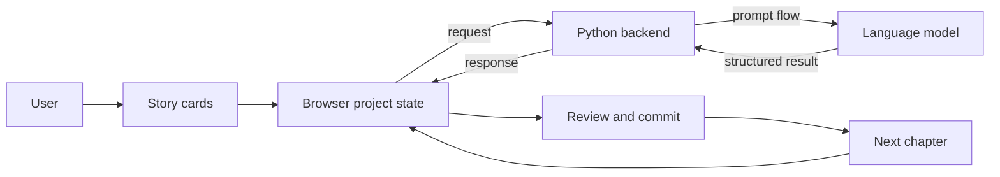
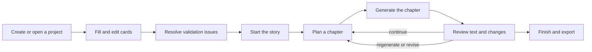

# Pulpermill

Pulpermill is a browser-based story-building tool. You define a story foundation, shape the next chapter, and use a language model to help write and evolve the story while you remain in control of the project.

## How it works



The browser owns the active project. It prepares requests, applies validation, reviews model results, commits accepted changes, and saves or exports the project. The backend runs individual operations and does not serve as the permanent story database.

## The user journey



The project is built from:

- **Style** — the intended voice and narrative qualities
- **Characters** — the people who may participate in the story
- **World** — places, objects, groups, rules, and terms
- **Entanglements** — relationships and holdings
- **Setup** — the protagonist, ordinary situation, disruption, and story length
- **Outline** — the beat for each chapter

After the story starts, the five foundation cards are locked. The outline remains the place where upcoming chapters are shaped.

## Model-assisted operations

Pulpermill exposes six model-call types:

| Call | Purpose |
|---|---|
| `fill` | Fill card content from user-provided material |
| `judge` | Evaluate card content against model-dependent rules |
| `style_fit` | Check whether the protagonist and style fit together |
| `plan` | Propose the next chapter beat |
| `generate` | Write a chapter and extract its structured consequences |
| `finish` | Provide the registered finishing operation |

The browser may combine several internal prompt steps into one public operation. For example, `generate` writes the chapter, summarizes what happened, and proposes relationship changes before returning one result for review.

## Repository map

```text
web/                  Browser application and project state
pulpermill/schema/    Project and card definitions
pulpermill/contract.py
                      Browser/backend request boundary
pulpermill/backend/  HTTP server, jobs, execution, and result assembly
pulpermill/prompts/  Prompt material renderers and token budgets
pulpermill/prompter/ Model-facing flows and prompt construction
tests/                Automated verification
evals/                Evaluation inputs and tooling
```

## Documentation

The current documentation is being rebuilt as a set of focused, current-state references:

- [User guide](docs/user-guide.md) — the complete user workflow
- [Architecture](docs/architecture.md) — how the codebase is connected
- [Model calls](docs/model-calls.md) — public model operations and their results
- [Value flow](docs/value-flow.md) — how card values reach prompts and later chapters
- [Cards and schema](docs/cards-and-schema.md) — the project data model
- [Backend API](docs/backend-api.md) — the client/backend integration
- [Running and configuration](docs/running-and-configuration.md) — operating the application
- [Terminology](docs/terminology.md) — the current product vocabulary

## Current-state rule

The documentation describes the current implementation. When an older design note conflicts with the code, the current code and its tests are the source of truth.
