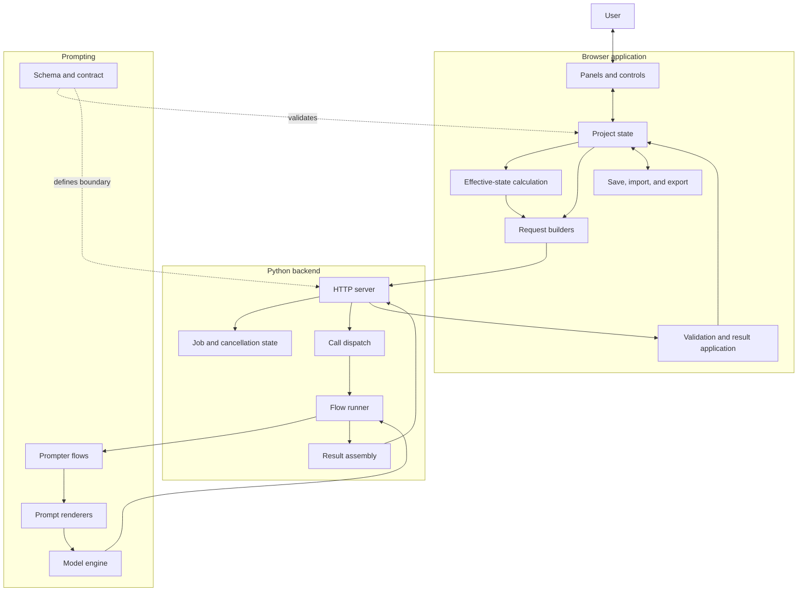
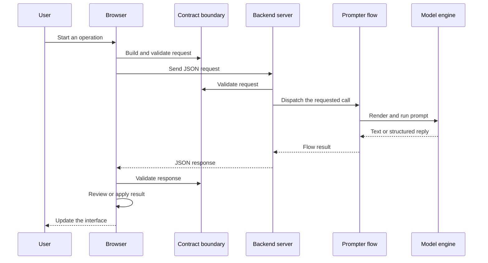
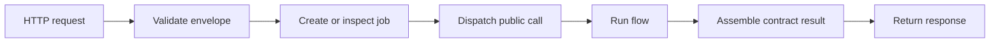
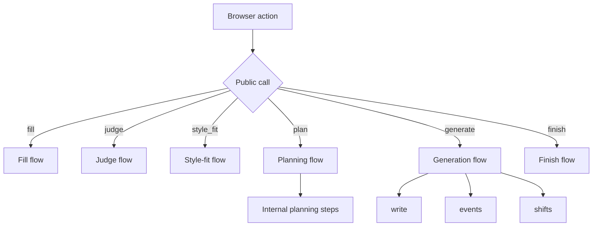
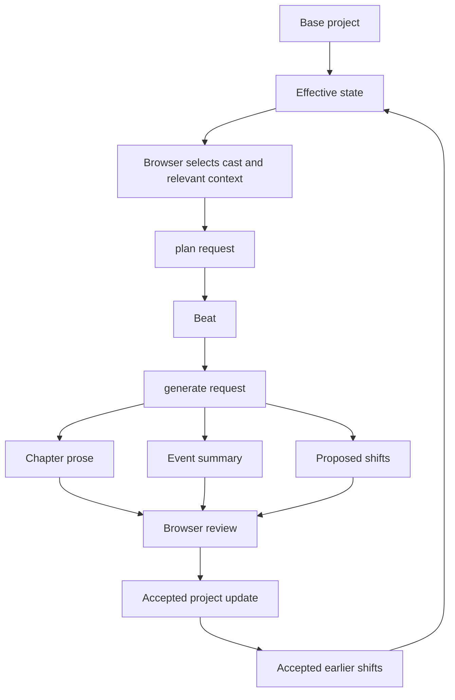

# Architecture

Pulpermill is a browser-led application connected to a stateless Python backend. The browser owns the project and user interaction. The backend executes individual operations and returns structured results.

## System at a glance



## The main boundary

The browser and backend communicate through the request and response types defined in [pulpermill/contract.py](/home/x/Documents/GitHub/pulpermill/pulpermill/contract.py).



The backend does not receive a permanent project session. A request contains the context needed for that operation. The browser keeps the project available between requests and decides when a returned result becomes part of that project.

## State ownership

```mermaid
flowchart LR
    subgraph Browser["Browser owns persistent working state"]
        P[Project cards]
        O[Outline beats]
        C[Chapters]
        H[Events and history]
        S[Accepted shifts]
        R[Undo and recovery]
        X[Exports]
    end

    subgraph Backend["Backend owns temporary execution state"]
        Q[Current request]
        J[Running job]
        L[Progress and cancellation]
        T[Temporary model result]
    end

    Browser -->|complete operation context| Backend
    Backend -->|structured response| Browser
```



### Browser responsibilities

The browser:

- Holds the active project
- Renders and edits cards
- Applies card and story-start validation
- Calculates effective state from accepted earlier changes
- Selects the chapter context
- Builds requests
- Displays model results for review
- Applies accepted results
- Manages undo and recovery behavior
- Saves, imports, and exports project data

### Backend responsibilities

The backend:

- Accepts and validates requests
- Prevents conflicting jobs from running at the same time
- Tracks job status and cancellation
- Dispatches public call types
- Runs prompt flows
- Handles prompt fitting, retries, and execution progress
- Converts model-facing replies into contract responses
- Returns errors explicitly

The backend does not decide whether a user accepts a proposed chapter or shift.

## Request path by layer

### Browser application

The [web/](/home/x/Documents/GitHub/pulpermill/web/) directory contains the browser application. Its main concerns are:

| Area | Role |
|---|---|
| Application assembly | Connect panels, state, client, import/export, and recovery |
| Card and story logic | Edit cards, validate state, and manage story-start behavior |
| Planning | Select chapter context and build `plan` requests |
| Generation | Build `generate` requests and apply chapter results |
| Effective state | Overlay accepted earlier shifts before later calls |
| Client transport | Send requests, poll status, stop jobs, and recover errors |
| Panels | Present cards, plans, chapters, end-story, and export interactions |

### Schema and contract

The schema package describes project data and card structure. The contract module defines the browser/backend boundary.

These are related but separate responsibilities:

- **Schema** describes cards, project records, fields, and rules.
- **Contract** describes requests, responses, errors, and public call types.

### Backend

The backend is organized around a request lifecycle:



The backend server handles transport and job management. Pipeline dispatch connects a public call to the configured prompter and execution context. The runner provides shared execution behavior rather than story-specific state management.

### Prompting

Prompt construction is split into two concerns:

1. **Renderers** convert structured context into model-facing material.
2. **Prompter flows** decide which material, instructions, and response format belong to a call.

The model engine is the execution boundary. It receives a prepared prompt and returns text or structured output. It does not own the browser project.

## Public calls and internal flow steps



The public call is the integration boundary. Internal steps may change as prompt flows evolve without becoming new browser API operations.

## Chapter request architecture

Planning and generation use different stages of the same browser-owned project state:



This is why later chapters can reflect earlier changes while the original foundation remains identifiable.

## Repository map

```text
web/
  Browser UI, project state, request builders, effective state, and exports

pulpermill/schema/
  Card and project structures, field metadata, and schema rules

pulpermill/contract.py
  Browser/backend request and response contract

pulpermill/backend/
  HTTP server, jobs, call dispatch, runner, and result assembly

pulpermill/prompts/
  Generic prompt renderers, token measurement, budgets, and limits

pulpermill/prompter/
  Prompter interface and model-facing call flows

tests/
  Automated tests for schema, browser behavior, backend behavior, and prompting

evals/
  Evaluation fixtures and tooling, separate from the user-facing documentation
```

## Responsibility matrix

| Concern | Browser | Backend | Prompter/model |
|---|---:|---:|---:|
| Store active project | Yes | No | No |
| Edit cards | Yes | No | No |
| Validate request shape | Yes | Yes | No |
| Select chapter context | Yes | No | No |
| Render model-facing material | Partly | Through prompting layer | Yes |
| Run model operation | No | Yes | Yes, through engine |
| Propose card or story content | No | No | Yes |
| Decide whether a result is accepted | Yes | No | No |
| Apply accepted project changes | Yes | No | No |
| Save and export project | Yes | No | No |
| Track a running job | No | Yes | No |

## The key architectural idea

Pulpermill separates **story ownership** from **model execution**:

```text
The browser owns the story.
The backend runs an operation.
The model proposes a result.
The browser decides what becomes story state.
```

This separation lets the user review, regenerate, undo, save, and export without making the model or backend the authoritative owner of the project.
