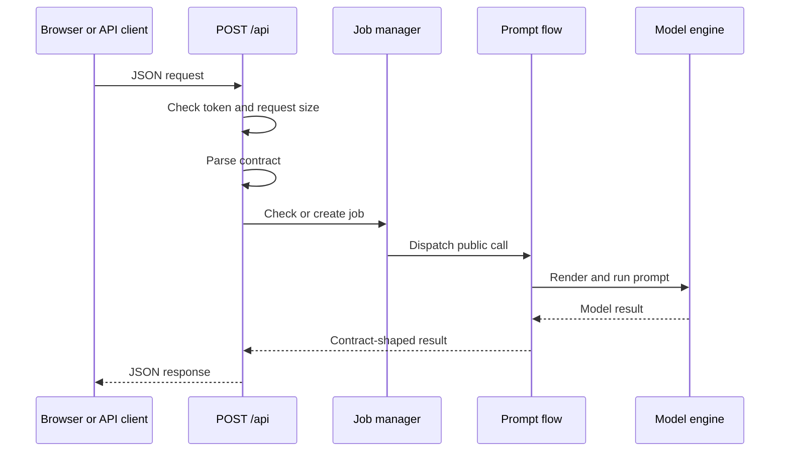
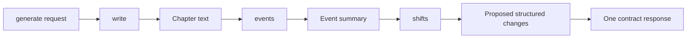
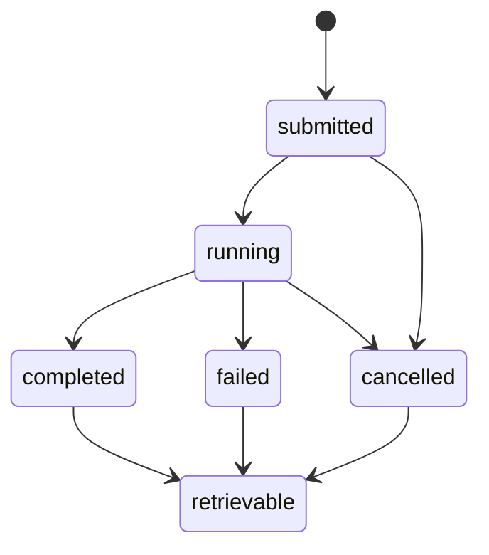

# Backend API

The Pulpermill backend exposes one HTTP route:

```text
POST <backend-address>/api
```

Every request is one JSON object with a `call` field. Every response is one JSON object with either:

```json
{ "ok": true, "...": "call-specific fields" }
```

or:

```json
{
  "ok": false,
  "error": {
    "kind": "bad_request",
    "detail": "..."
  }
}
```

The request and response models are defined in [pulpermill/contract.py](/home/x/Documents/GitHub/pulpermill/pulpermill/contract.py). The backend validates both incoming requests and model results before returning them.

## Request lifecycle



The backend runs one model call at a time. A request that arrives while another model call is running receives a `busy` error.

## Common request fields

All model-call requests include the fields inherited from the common envelope:

| Field | Meaning |
|---|---|
| `call` | Public operation name |
| `schema_version` | Project-file version understood by the client |
| `language` | Language the model should write in |
| `job_id` | Optional client-generated identifier for recovery |

The backend rejects a request whose `schema_version` is newer than the server’s supported project schema.

The `job_id` must be 8–64 characters and contain only letters, numbers, `_`, or `-`.

## Public model calls

| `call` | Main request contents | Main response |
|---|---|---|
| `fill` | Card, source note/example, current card values, related cards | Proposed card values |
| `judge` | Card, requested model rules, values, related cards | One result per requested rule |
| `style_fit` | Style and protagonist | Style-fit result |
| `plan` | Effective story context, selected spotlight, earlier beats/events, options | Structured plan result |
| `generate` | Effective story context, earlier events, previous ending, beat | Chapter, events, and shifts |
| `finish` | Setup, protagonist, base characters, event summaries | Finishing shifts/result |

The browser prepares and reduces story context before sending `plan` or `generate`. The backend does not select the cast, create project IDs, or apply shifts.

## `fill`

```json
{
  "call": "fill",
  "schema_version": 4,
  "language": "en",
  "card": "characters",
  "instance": "character-id",
  "note": "A harbor clerk who distrusts her brother.",
  "example_chapter": null,
  "values": {},
  "related": {}
}
```

`card` can be:

- `style`
- `characters`
- `world`
- `entanglements`
- `setup`

The request must include a note or an example chapter. Character fills identify the character instance; other card fills do not.

The response has this shape:

```json
{
  "ok": true,
  "values": {
    "name": "Mara",
    "sketch": "A careful clerk who notices what others overlook."
  }
}
```

References in the model result are returned in readable form where necessary. The browser resolves them against its own project records before applying the values.

## `judge`

```json
{
  "call": "judge",
  "schema_version": 4,
  "language": "en",
  "card": "world",
  "instance": null,
  "rules": [
    {
      "id": "everyday_has_friction",
      "fields": ["everyday_life"]
    }
  ],
  "values": {
    "everyday_life": "..."
  },
  "related": {}
}
```

The client sends only rules that need model judgment. Deterministic validation remains in code.

A judge result identifies the rule and any affected fields or items:

```json
{
  "ok": true,
  "results": [
    {
      "rule": "everyday_has_friction",
      "hits": []
    }
  ]
}
```

An empty `hits` list means that the requested rule found no problem.

## `style_fit`

```json
{
  "call": "style_fit",
  "schema_version": 4,
  "language": "en",
  "style": {
    "person": "third",
    "tense": "past",
    "distance": "close"
  },
  "protagonist": {
    "id": "mara",
    "name": "Mara",
    "sketch": "..."
  }
}
```

This call evaluates whether the protagonist can support the selected narrative style. The result is used by the browser’s story-start gate and does not modify either card.

## `plan`

`plan` and `generate` share the current story context:

```json
{
  "schema_version": 4,
  "language": "en",
  "chapter": 1,
  "chapter_count": 8,
  "style": {},
  "setup": {},
  "protagonist": "mara",
  "cast": [],
  "world": {},
  "ties": [],
  "holdings": [],
  "spotlight_edges": [],
  "pressure": null
}
```

The `plan` request adds:

```json
{
  "call": "plan",
  "spotlight": "tie-id",
  "earlier_beats": [],
  "earlier_events": [],
  "retry": null,
  "choose": false,
  "pressure_options": [],
  "pressure_used": [],
  "origin_history": true
}
```

The spotlight must refer to one of the ties included in the request. When `choose` is enabled, the request may include the world rules and objects from which the planner can choose pressure.

The response is a structured plan result containing the fields needed to create or update the beat, including location, time, aim, and plan text. The exact response model is validated by the contract before it reaches the browser.

## `generate`

The `generate` request uses the same story context as `plan` and adds:

```json
{
  "call": "generate",
  "earlier_events": [],
  "previous_ending": null,
  "beat": {
    "chapter": 1,
    "where": "customs-office-id",
    "when_time": "late afternoon",
    "cast": ["mara", "iven"],
    "spotlight": "tie-id",
    "pressure": "rule-id",
    "aim": "Find out why the lighthouse signal changed.",
    "plan": "Mara confronts Iven while the harbor closes.",
    "outcome": "lost"
  }
}
```

The public call contains internal generation steps:



The browser validates and applies the response. A failed or stopped generation changes nothing.

## `finish`

The registered `finish` request uses the base character cards and event summaries:

```json
{
  "call": "finish",
  "schema_version": 4,
  "language": "en",
  "setup": {},
  "protagonist": "mara",
  "characters": [],
  "events": []
}
```

The protagonist must be one of the characters sent, and at least one character and event entry are required.

The current browser end-story panel creates its after-story copy locally and does not call `finish`. The endpoint remains available as a registered backend capability for clients or flows that use it.

## Job lifecycle

### Without a `job_id`

The request remains connected until it completes, fails, is cancelled, or the client disconnects. If the client disconnects, the backend cancels the call.

### With a `job_id`

The backend keeps the call and its final outcome in memory so the client can recover after a lost connection.



Finished named jobs are retained according to the server configuration. The default is 30 finished jobs. A server restart forgets all jobs.

## `status`

`status` is a control operation, not a model call:

```json
{
  "call": "status"
}
```

While idle:

```json
{
  "ok": true,
  "state": "idle"
}
```

While busy, the response can include the current progress stage:

```json
{
  "ok": true,
  "state": "busy",
  "stage": {
    "name": "write",
    "index": 1,
    "of": 3
  }
}
```

The stage name is a short contract-safe identifier. The exact internal stages depend on the operation and configured prompter.

## `job`

Use `job` to recover a named call:

```json
{
  "call": "job",
  "job_id": "chapter-0001"
}
```

While the call is running:

```json
{
  "ok": true,
  "state": "running",
  "stage": {
    "name": "events",
    "index": 2,
    "of": 3
  }
}
```

If the job is unknown:

```json
{
  "ok": true,
  "state": "unknown"
}
```

When a named job has finished, `job` returns the original call’s normal success response or error response, not a separate wrapper.

## `cancel`

Cancel the currently running operation:

```json
{
  "call": "cancel"
}
```

Or cancel a named job:

```json
{
  "call": "cancel",
  "job_id": "chapter-0001"
}
```

The response is:

```json
{
  "ok": true,
  "state": "cancelled"
}
```

If the named job is missing or already finished, the state is `unknown`.

A cancelled model call does not produce an applicable project result.

## Errors

| Error kind | HTTP status | Meaning |
|---|---:|---|
| `busy` | 503 | Another model operation is running |
| `bad_request` | 400 | JSON, envelope, field, schema-version, or request-size problem |
| `bad_output` | 502 | The model result could not satisfy the response contract |
| `too_long` | 413 | The prepared prompt cannot fit the configured context |
| `stopped` | 409 | The operation was cancelled or stopped |
| `server` | 500 | Unexpected backend or model-server failure |
| `unauthorized` | 401 | The configured token was missing or incorrect |

Example:

```json
{
  "ok": false,
  "error": {
    "kind": "busy",
    "detail": ""
  }
}
```

The backend does not return a success-shaped fallback for failed calls. The browser treats a failed call as having made no project change.

## Authentication and headers

The browser sends:

```http
Content-Type: application/json
ngrok-skip-browser-warning: 1
```

When the server is configured with a token, the browser also sends:

```http
x-pulpermill-token: <shared-secret>
```

The token is optional at the server level. When configured, it is checked before the request body is processed. CORS preflight requests are answered without requiring the token.

## Request size and transport behavior

The default maximum request body is 4,000,000 bytes. Requests larger than that receive `bad_request`.

Long-running calls are streamed after the server’s stream threshold so that response headers are sent before model execution finishes. The body remains the same contract response; whitespace heartbeat chunks do not change the JSON result.

The browser’s default model-call timeout is 15 minutes for `fill`, `judge`, `style_fit`, `plan`, and `generate`. `status` uses a five-second timeout. A client integrating independently should choose timeouts appropriate to its deployment and use named jobs when it must recover from a lost connection.

## Client behavior

The browser client sends real backend requests to `<configured-address>/api`. It also supports a local mock mode for working without a backend.

For a real backend, the client:

1. Sends a JSON request.
2. Polls `status` while a story call runs.
3. Displays the current stage.
4. Stops or recovers the call when needed.
5. Reads the final contract response.
6. Lets browser-side logic validate and apply the result.

The transport layer does not mutate project state. Project changes happen in the browser’s call-specific logic after a successful response.

## Integration rule

An API client should treat the backend as an operation service:

```text
send complete context
→ receive a proposed or generated result
→ validate the response
→ decide whether to commit it to local project state
```

The backend is not a project database and does not apply returned shifts to the caller’s project. The caller remains responsible for maintaining the project and deciding when a successful result becomes story state.
