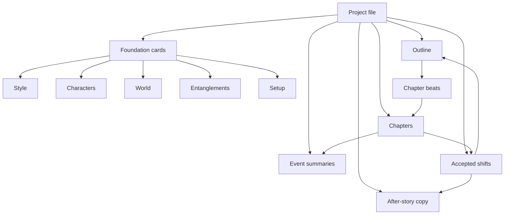
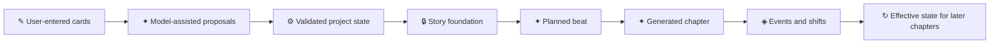
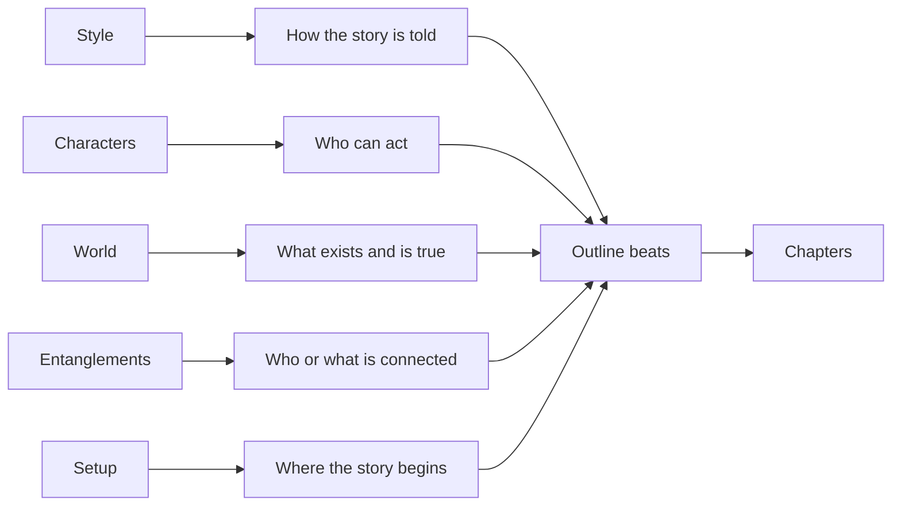
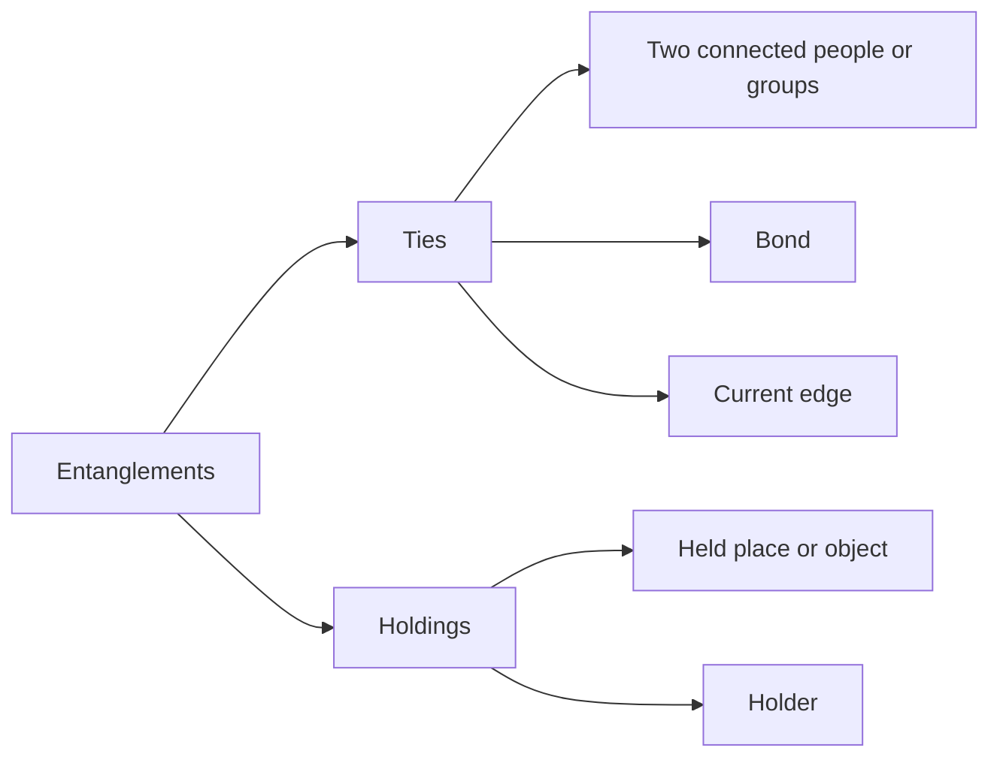
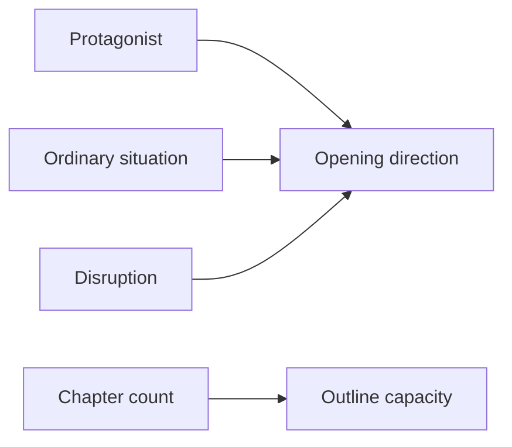
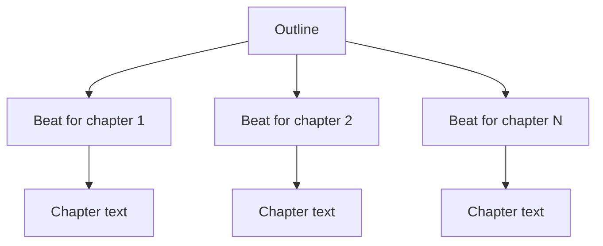
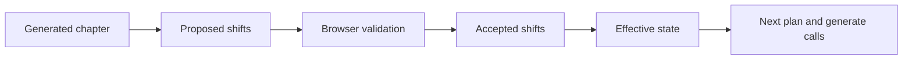
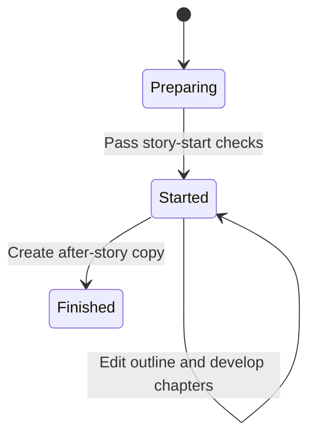

# Cards and schema

Pulpermill stores one story as a project. The project contains user-facing cards, growing outline and chapter records, and hidden records used to carry generated history forward.

## Project shape



The project file also stores project metadata, optional material used for card filling, locks, and display notes about generated results.

## What is editable, derived, or hidden?

| Symbol | Meaning |
|---|---|
| ✎ | User edits the value directly |
| ✦ | The model may propose the value |
| ⚙ | Browser or code derives the value |
| 🔒 | Locked after the story starts or by an explicit lock |
| ↻ | Recomputed from accepted chapter results |
| ◈ | Hidden project record used for continuity |



Model assistance never bypasses the project boundary: a returned value is validated and then applied by the browser.

## Foundation cards



### Style

Style describes how the story is told. It includes:

- Narrative person and tense
- Narrative distance, humor, and pacing
- Rhythm, diction, formality, imagery, edge, and explicitness
- Attitude
- Dialogue amount, directness, polish, and voice difference
- Lens and genre
- Optional notes for the narrator, sentences, stance, and dialogue

Style is a portable, static foundation card. Its option values are rendered into model-facing writing instructions.

### Characters

Characters describe the people who may participate in the story. A project may contain multiple character records.

Each character can include:

- Name, age, sex, appearance, and a short sketch
- Wants, fear, flaw, and values
- Behaviors
- Competence, vulnerability, and speech
- History

Character identities are stable. Story development can update supported non-identity character fields through accepted shifts, while the original foundation remains available.

### World

World describes what exists and what is true without assigning ownership or relationships.

It includes:

- World name
- Era and technology
- Everyday life
- History
- Places
- Objects
- Powers or groups
- Rules
- Terms and meanings

World entries provide context for planning and writing. The browser may select only the relevant entries for a particular chapter.

### Entanglements

Entanglements connect people, groups, places, and objects. It contains two sections:



**Ties** contain:

- Two ends
- The underlying bond
- The current edge or meaning of the tie for the `from` side

**Holdings** connect a place or object to an allowed holder such as a character, group, or place.

Entanglements are the relationship and possession context that can become a chapter spotlight, influence scene selection, and receive chapter shifts.

### Setup

Setup is the story’s launch point:

- Protagonist
- Ordinary situation
- Disruption
- Chapter count



Setup is a static story foundation. The protagonist must refer to an existing character.

## Outline and beats

The Outline is the growing card. It gains one beat per chapter and is not the same kind of static foundation as Style, Characters, World, Entanglements, and Setup.



A beat contains:

| Field | Role |
|---|---|
| `chapter` | Chapter number, assigned by code |
| `stale` | Indicates that a later regeneration made the beat need attention |
| `where` | Selected story location |
| `when_time` | Time of the scene |
| `cast` | Characters selected for the chapter |
| `spotlight` | The relationship tie receiving attention |
| `pressure` | A selected world rule or object creating immediate difficulty |
| `aim` | What the protagonist is after |
| `plan` | The planner’s scene plan |
| `outcome` | Whether the planned aim is reached, lost, or given up |
| `planned_from` | Code-generated record of the state used to plan the beat |

The human selects the cast before planning. Code can select or provide the spotlight and pressure, and the planner supplies the main beat text.

## Chapter and hidden continuity records

### Chapters

A chapter stores the written text and points to its beat. The chapter number lives on the beat rather than being duplicated on the chapter record.

Regenerating a chapter replaces its text and related generated records while keeping the beat and marking later beats stale where required.

### Event summaries

Event summaries are hidden records generated from chapter text. Each entry points to its beat and contains:

- `happened` — what occurred in the chapter
- `changed` — a short statement of what changed, when applicable

They provide compact history for later planning and writing.

### Shifts

Shifts are hidden records containing accepted structured changes from generated chapters.



Current chapter shifts target Entanglements. They are sparse patches that can add, replace, or remove supported list items, or update supported fields according to the schema rules. The World card does not change through chapter shifts.

Character shifts are supported by the shift record for the broader story state, including the end-of-story case, while ordinary chapter shifts are restricted to Entanglements.

## Story-start locks



When the story starts, the browser applies story locks to the five static foundation cards:

- Style
- Characters
- World
- Entanglements
- Setup

The Outline remains active so the user can plan the next beat. Individual user-created locks may also restrict a card, field, list item, or item part before or after story start.

## Relationships between records

```mermaid
erDiagram
    PROJECT ||--|| STYLE : contains
    PROJECT ||--o{ CHARACTER : contains
    PROJECT ||--|| WORLD : contains
    PROJECT ||--|| ENTANGLEMENTS : contains
    PROJECT ||--|| SETUP : contains
    PROJECT ||--|| OUTLINE : contains
    OUTLINE ||--o{ BEAT : contains
    BEAT ||--o| CHAPTER : points_to
    BEAT ||--o| EVENTS : summarizes
    BEAT ||--o{ SHIFT : records
    CHARACTER ||--o{ TIE : participates
    WORLD ||--o{ HOLDING : provides
    CHARACTER ||--o{ HOLDING : holds
```

The links in the stored project use IDs. The browser uses those IDs to keep references valid, while prompt renderers present names and descriptions to the model.

## Validation levels

Project values can fail or raise issues at different levels:

| Level | Meaning |
|---|---|
| Reject | The value cannot be stored because its type, option, or structure is invalid |
| Block | The project may be saved, but the workflow cannot proceed until the issue is fixed |
| Warn | The value may be kept, but the user receives advice or a model-dependent judgment |

Examples include:

- Broken references between cards
- A protagonist that no longer exists
- A beat whose spotlight is not represented in its cast
- A tie that points to itself
- A holding that uses an invalid holder
- A shift that changes a fixed identity field

The browser uses these results to decide whether the user can move to the next workflow stage.

## Portable and story-specific information

Some cards can stand alone more easily than others:

| Card | Role | Story relationship |
|---|---|---|
| Style | Portable writing direction | Does not depend on a particular cast or world |
| Characters | Portable character descriptions | Identity and traits do not contain ties |
| World | Portable setting description | Describes facts without assigning ownership |
| Entanglements | Story glue | References characters and world items |
| Setup | Story launch | References the project protagonist and story context |
| Outline | Growing chapter plan | References current project state and history |

This separation prevents relationships, ownership, and current story state from being hidden inside portable descriptions.

## After-story copy

The after-story copy is created from the browser’s final state. It contains:

- Style
- Characters
- World
- Final Entanglements

The original project remains intact. The copy represents the state after the story’s accepted changes have been folded into the cards and can be downloaded or used as a new starting point.

## A compact example

```text
Style:
  Close, past-tense harbor noir

Characters:
  Mara, a harbor clerk
  Iven, her estranged brother

World:
  The Salt Coast customs office
  A lighthouse and its key

Entanglements:
  Mara distrusts Iven
  Iven holds the lighthouse key

Setup:
  The lighthouse signal changes during Mara's ordinary shift

Beat:
  Mara confronts Iven at the customs office

Chapter result:
  The event summary records what happened
  A shift proposes how the tie changed
  The next effective state uses the accepted relationship change
```

The cards define the foundation, the beat defines the immediate scene, and the hidden records carry accepted consequences into the next chapter.
