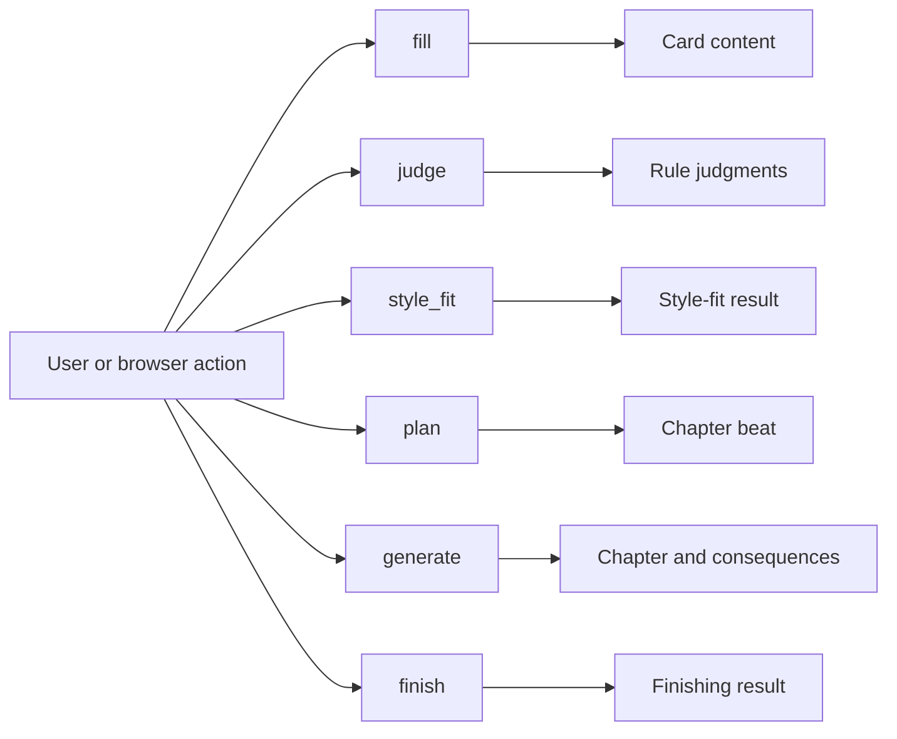
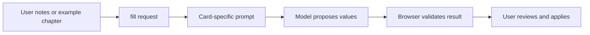
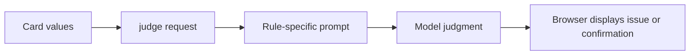
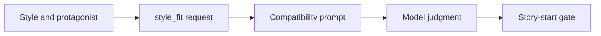
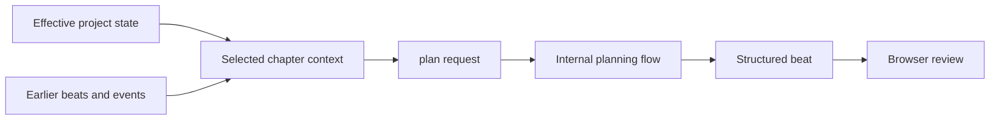
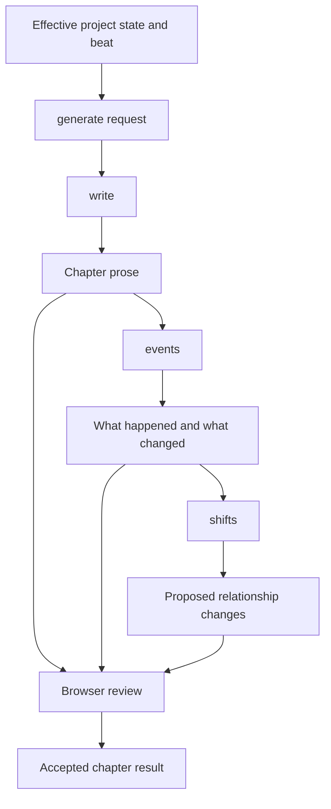
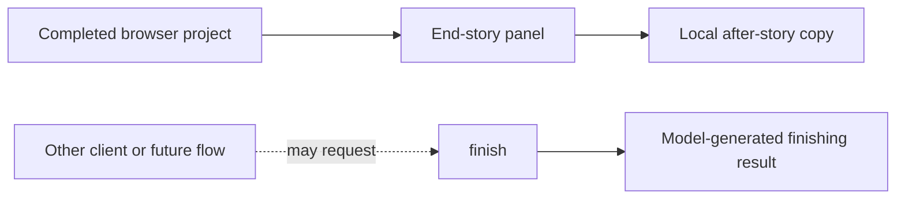
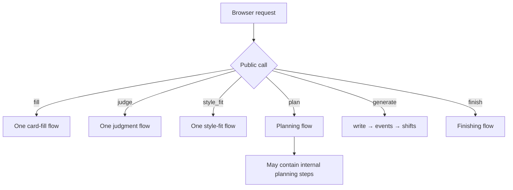
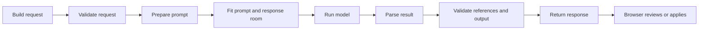
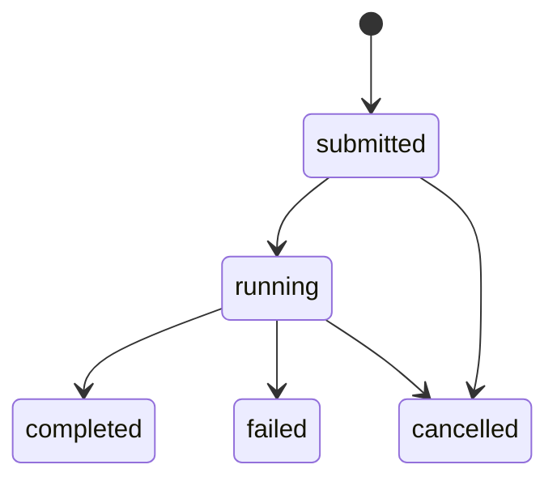

# Model calls

Pulpermill exposes six public model-call types. A public call is the operation the browser requests. Some calls contain several internal prompt steps, but those steps are not separate browser API operations.

## The six calls at a glance



| Call | Purpose | Main result |
|---|---|---|
| `fill` | Turn user material into card content | Proposed card values |
| `judge` | Evaluate content against model-dependent rules | Rule judgments and issues |
| `style_fit` | Evaluate the protagonist/style combination | Style-fit judgment |
| `plan` | Propose the next chapter beat | Structured beat |
| `generate` | Write a chapter and extract its consequences | Chapter text, event summary, and shifts |
| `finish` | Provide the registered finishing operation | Finishing-related structured result |

The browser validates and applies results. The model does not directly edit the project.

## `fill`

### What it does

`fill` proposes values for a card from user-provided material such as notes or an example chapter. It can use existing project context when the card depends on information already established elsewhere.

### Typical path



### Result

The result contains proposed values for the requested card or item. References to existing project items must resolve to the browser’s project data before the result can be applied.

### Project effect

`fill` proposes content. The browser decides whether to apply it to the card.

## `judge`

### What it does

`judge` handles validation rules that require model judgment rather than a deterministic code check. It evaluates existing card content against the relevant rule prompt.

### Typical path



### Result

The result reports the outcome of the requested model-dependent checks. It supplements structural validation; it does not replace required-field, type, reference, or other code-level checks.

### Project effect

`judge` reports issues or confirmations. It does not change the card automatically.

## `style_fit`

### What it does

`style_fit` evaluates whether the selected protagonist fits the project’s style and story foundation.

### Typical path



### Result

The result provides the style-fit judgment used by the story-start flow.

### Project effect

The result helps the browser decide whether the story-start gate can proceed. It does not rewrite the style or protagonist.

## `plan`

### What it does

`plan` proposes the next chapter’s structured beat from the effective project state and the chapter context selected by the browser.

The beat can include:

- Chapter number
- Location
- Time
- Cast
- Spotlight
- Pressure
- Aim
- Plan
- Intended outcome

### Planning path



The browser reduces the project context before sending it. The model receives the material selected for planning, not necessarily every item in the project.

### Internal steps

The configured prompter may use several internal planning steps, such as brainstorming, selection, decision, or labeling. These are implementation details inside the public `plan` operation.

### Project effect

The beat becomes part of the browser’s outline only when the browser accepts or applies it.

## `generate`

### What it does

`generate` develops an accepted or selected beat into a chapter and extracts structured information needed for continuity.

### Generation path



### Internal steps

The current generation flow contains:

1. **`write`** — produces the chapter prose.
2. **`events`** — extracts what happened and what changed.
3. **`shifts`** — proposes applicable relationship changes.

These are internal steps of `generate`, not separate public calls.

### Result

The response can contain:

- Chapter text
- A summary of what happened
- A summary of what changed
- Proposed shifts to supported relationship state

### Project effect

The browser validates the result and decides whether to commit the chapter, event summary, and shifts. Accepted shifts contribute to the effective state used by later chapters.

## `finish`

### What it does

`finish` is a registered backend and prompter capability for finishing-related model work.

### Current browser behavior

The current browser end-story workflow does not use the backend `finish` call. The end-story panel creates the after-story copy locally from the browser’s project state.



This distinction matters: a call can exist in the backend contract without being part of the active browser path.

## Public calls versus internal steps



The public call names are the stable integration surface. Internal step names describe how a configured prompter performs the operation.

## Common call lifecycle



The runner handles shared execution concerns such as prompt fitting, retries, cancellation, progress, language checks, and response handling. Call-specific flows provide the prompts and result structures.

## Operations that are not model calls

The backend also supports job-management operations. They control execution but do not ask the language model to generate story content.

| Operation | Purpose |
|---|---|
| `status` | Check backend or current job status |
| `job` | Retrieve the state or result associated with a running operation |
| `cancel` | Request cancellation of a running operation |



These operations are part of the request lifecycle around a model call:

```text
submit model call → observe status → receive result
                              ↘ cancel if needed
```

## Who decides what

| Decision | Code | Model |
|---|---:|---:|
| Whether the request has the correct shape | Yes | No |
| Which project records are selected | Yes | No |
| Which cast and context are sent | Yes | No |
| What card content to propose | No | Yes |
| Whether a model-dependent rule appears satisfied | No | Yes |
| What the next beat should be | No | Yes |
| How the chapter is written | No | Yes |
| What happened in the generated chapter | No | Yes |
| Which supported relationship changes to propose | No | Yes |
| Whether a result becomes project state | Yes | No |
| Whether a job is cancelled | Yes | No |

The model supplies proposals and judgments within the requested operation. The browser and backend enforce the contract and the browser remains the authority for project state.
