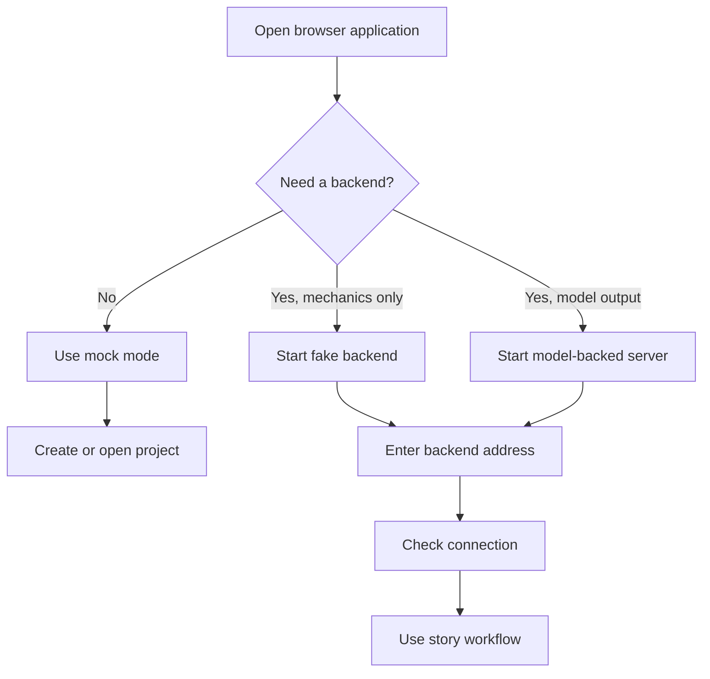
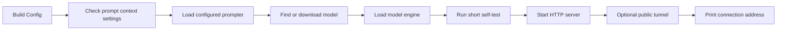
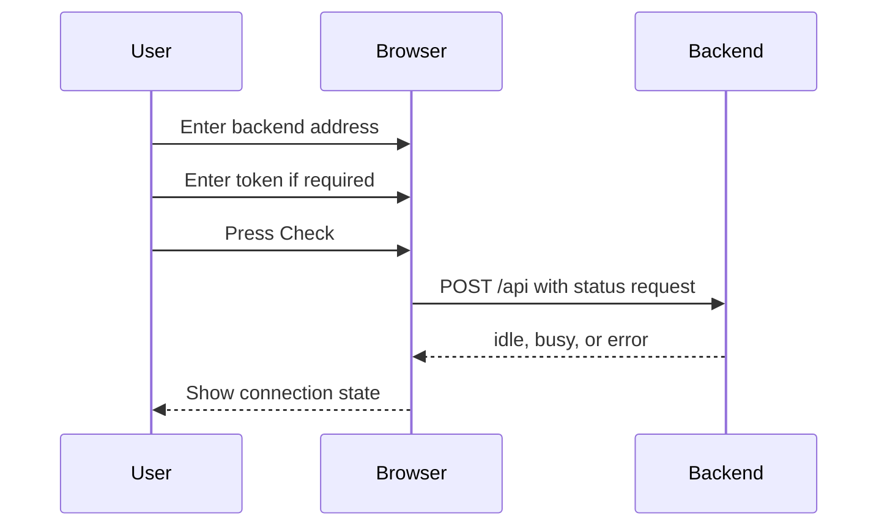
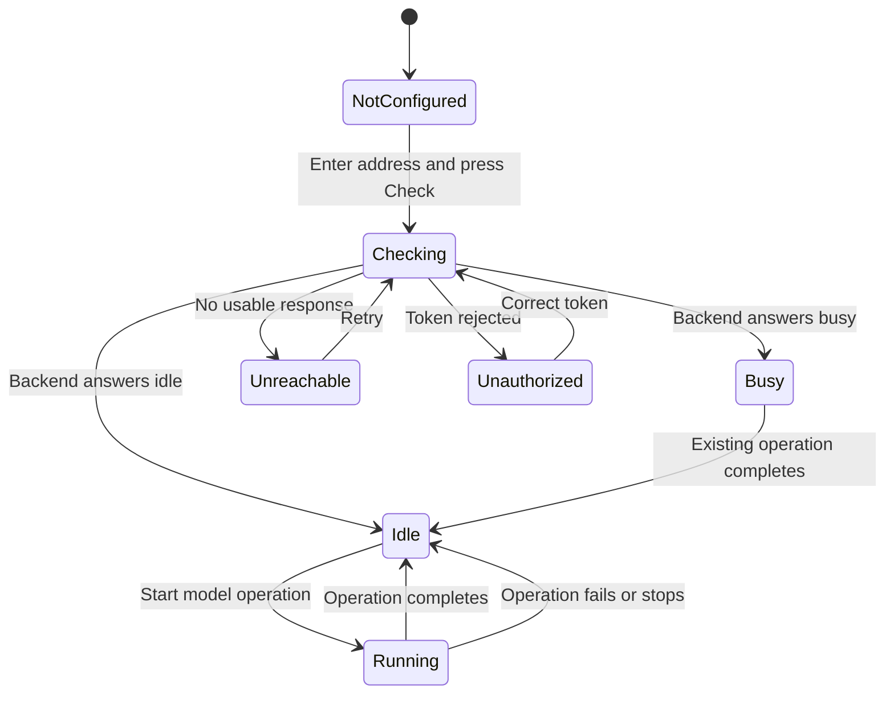

# Running and configuration

Pulpermill has two runtime parts:

1. The browser application in [web/](/home/x/Documents/GitHub/pulpermill/web/).
2. The Python backend in [pulpermill/backend/](/home/x/Documents/GitHub/pulpermill/pulpermill/backend/).

The browser can run in local mock mode. A backend can run with the fake engine for mechanics testing or with a configured model engine for model-backed operation.

## Runtime choices



| Mode | Purpose | Model required |
|---|---|---:|
| Browser mock | Work with the interface and canned local behavior | No |
| Fake backend | Exercise HTTP, job, contract, and page integration | No |
| Model-backed backend | Produce real model-assisted cards, plans, and chapters | Yes |

## Starting the fake backend

The command-line backend entry point is intended for the fake engine:

```bash
python -m pulpermill.backend --fake
```

By default it listens at:

```text
http://127.0.0.1:8000
```

Useful options:

```bash
python -m pulpermill.backend --fake --host 127.0.0.1 --port 8000
python -m pulpermill.backend --fake --token YOUR_SHARED_SECRET
python -m pulpermill.backend --fake --seconds-per-token 0
```

The fake engine returns canned responses and does not require a GPU or downloaded model. It is useful for checking the interface and transport mechanics, not for judging story quality.

## Starting the model-backed server

The model-backed launch path is exposed through [pulpermill/backend/launch.py](/home/x/Documents/GitHub/pulpermill/pulpermill/backend/launch.py). It is designed to be called by the notebook or another Python entry point:

```python
from pulpermill.backend.launch import launch

launch(
    token="your-shared-secret",
    ngrok_authtoken="your-ngrok-token",
)
```

The launch sequence is:



Before the server becomes available, the launcher:

- Validates the configured prompter name.
- Checks that the model context size matches the prompt budget configuration.
- Finds or downloads the configured model.
- Loads the engine.
- Runs a short generation self-test.
- Starts the server and waits for it to be ready.
- Optionally opens a public tunnel.

The launch banner prints the address to enter into the browser’s **Model connection** field. If a token is configured, enter the same shared secret in the browser’s token field.

## Connecting the browser

The browser connection controls are in [web/index.html](/home/x/Documents/GitHub/pulpermill/web/index.html).



Enter either:

```text
mock
```

or a backend address such as:

```text
http://127.0.0.1:8000
```

The client normalizes an address without a scheme to HTTP and sends requests to its `/api` path. It sends these headers:

```http
Content-Type: application/json
ngrok-skip-browser-warning: 1
```

When a token is entered, it also sends:

```http
x-pulpermill-token: <shared-secret>
```

## Configuration overview

The central runtime configuration is [pulpermill/backend/config.py](/home/x/Documents/GitHub/pulpermill/pulpermill/backend/config.py).

### Server settings

| Setting | Default | Purpose |
|---|---:|---|
| `host` | `127.0.0.1` | Bind address in the base configuration |
| `port` | `8000` | HTTP port |
| `token` | unset | Optional shared secret |
| `prompter` | `stub` | Prompter module used for calls |
| `jobs_kept` | `30` | Finished named jobs retained in memory |
| `max_body_bytes` | `4,000,000` | Maximum request body size |
| `stream_after` | `20` seconds | Delay before long responses begin streaming |
| `heartbeat` | `15` seconds | Whitespace heartbeat interval for streamed responses |

The model-backed launcher overrides the host to `0.0.0.0` so a tunnel or external client can reach the server.

### Model settings

The model configuration includes:

- Model repository and file name
- Search and storage directories
- Context size
- Batch size
- GPU tensor split
- Flash attention and sliding-window settings
- KV-cache type
- Minimum free VRAM
- Download retry and disk-headroom settings

The launcher checks that `model.n_ctx` matches the prompt budget’s context size. A mismatch stops startup instead of allowing prompts to run with inconsistent limits.

### Sampling settings

Sampling is configured separately for:

- Free prose
- Free thinking
- Structured JSON
- Chinese prose

The configured prompter and flow choose the appropriate sampling category for each internal step.

## Tokens and secrets

The backend token is an optional shared secret used to protect the API:

```bash
PULPERMILL_TOKEN=YOUR_SHARED_SECRET
```

The command-line fake server can also receive it directly:

```bash
python -m pulpermill.backend --fake --token YOUR_SHARED_SECRET
```

Do not put secrets in project files, documentation, commits, or exported story data. The browser stores the token separately from the backend address and does not include it in project exports.

The model-backed launcher also accepts a Hugging Face token for model downloads. That token is used through the environment and is not written to logs.

## Logs and diagnostics

### Run log

The model-backed launcher defaults to a JSON-lines run log at:

```text
/kaggle/working/pulpermill-runs.jsonl
```

Each completed call can record timing, result, stages, retries, and prompter information. The fake command-line server has no persistent log path unless its configuration is changed by the caller.

### Debug capture

Debug capture is off by default. When enabled, refused attempts and their problem information are written to a JSON-lines file. The file may contain story text and model replies.

Treat debug files as sensitive working data:

- Do not commit them.
- Do not share them by default.
- Delete or protect them after diagnosing the issue.

### Trace capture

Trace capture records every prompt and reply attempt. It is also off by default and may contain the full story context.

Use it only when detailed prompt-level diagnosis is required, and keep it outside version control.

## Connection and startup flow



## Troubleshooting

| Symptom | First checks |
|---|---|
| Browser shows mock mode | Replace `mock` with the backend address if a real server is intended |
| Connection is unreachable | Confirm the server is running, the address includes the correct port, and the browser can reach it |
| Unauthorized response | Confirm the browser token exactly matches the configured backend token |
| Backend reports busy | Wait for the current model operation or stop it before starting another |
| Request is rejected | Check the request shape, schema version, required fields, and request size |
| Prompt is too long | Reduce the context or use the configured prompt-fitting behavior; verify model context and budget settings agree |
| Model server will not start | Check prompter name, model file availability, context-size agreement, disk space, and free VRAM |
| Model starts but generation fails | Read the run log, check model-engine output, and use debug/trace capture only when needed |
| Named job cannot be recovered | Confirm the job ID and remember that jobs are held in memory and disappear after a server restart |
| Public tunnel cannot be used | Confirm the tunnel token, public URL, backend token, and browser network/security settings |

## Browser and page security constraints

The browser refuses a mixed-content connection from an HTTPS page to a remote HTTP backend. Plain HTTP is allowed for local addresses such as `localhost`, `127.0.0.1`, and `::1`.

For a remote browser connection, use HTTPS or the public HTTPS address supplied by the tunnel.

## Recommended operating modes

### Interface development

Use browser mock mode when you are checking page behavior without a backend.

### Contract and integration testing

Use the fake backend:

```bash
python -m pulpermill.backend --fake
```

This tests the HTTP boundary and canned call flow without requiring model hardware.

### Real story generation

Use the model-backed launcher after configuring:

- A compatible model file
- Sufficient disk and GPU memory
- A matching prompt context size
- A selected prompter
- Optional backend and model-download tokens
- A reachable browser connection address

Always wait for the self-test and ready banner before connecting the browser.
