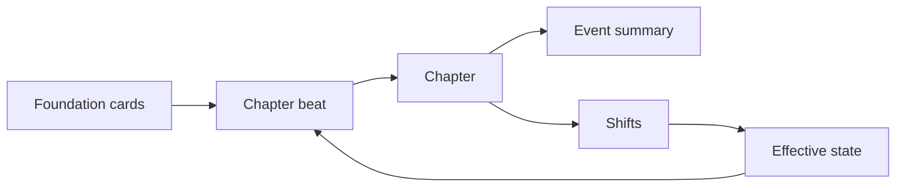
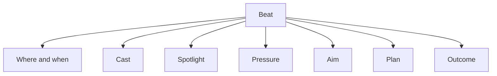
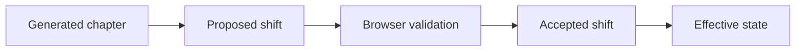
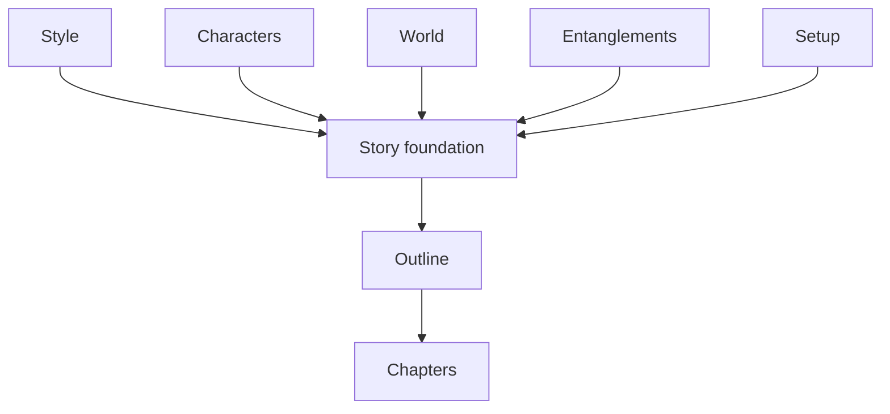
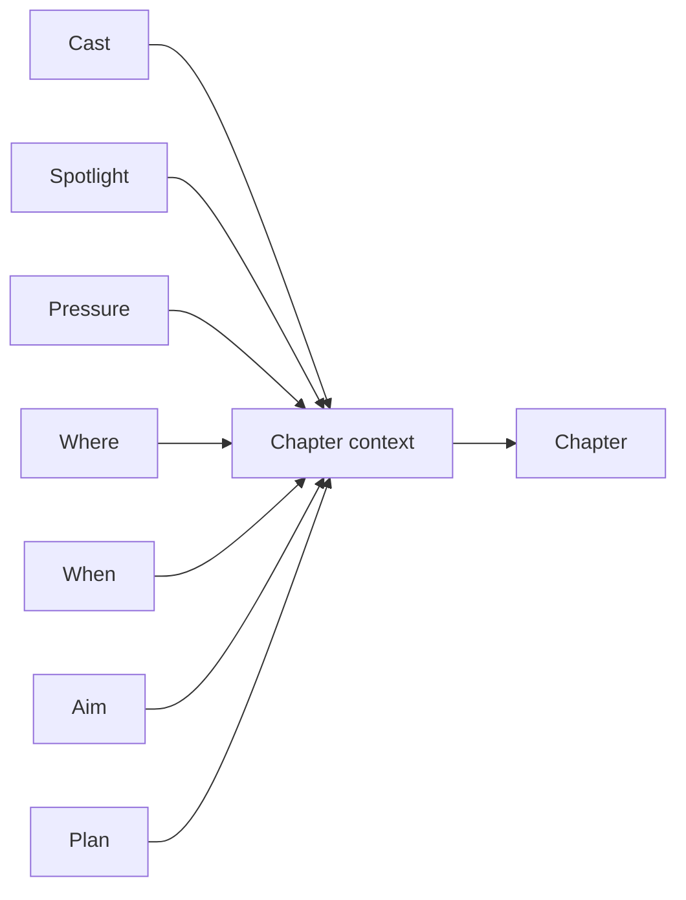
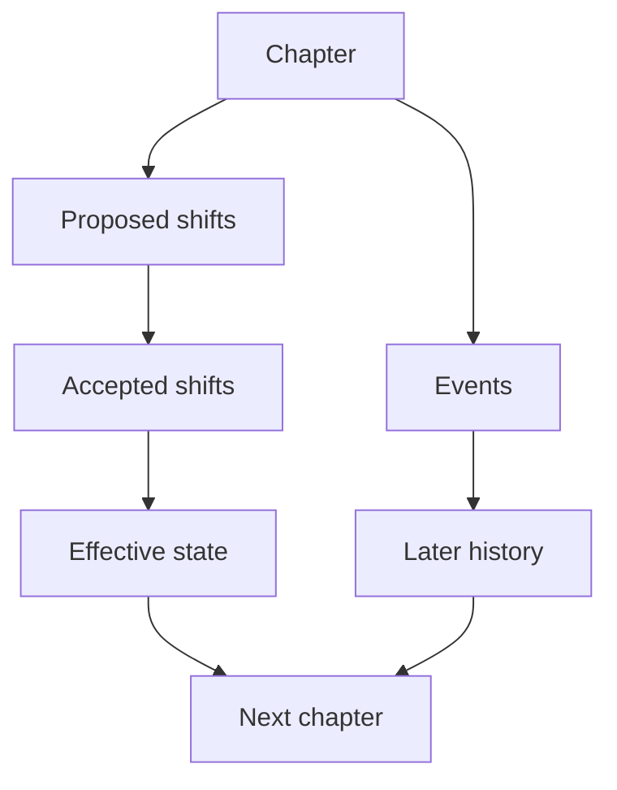

# Terminology

This glossary defines the current Pulpermill vocabulary. It describes the terms used by the browser workflow, project data, backend calls, and model prompts.

## At a glance



## Terms

### After-story

The browser-created copy of the story’s final state after the chapters have been developed. It contains the final Style, Characters, World, and Entanglements cards. The current browser creates it locally rather than calling the registered backend `finish` operation.

### Aim

What the protagonist is trying to achieve in a chapter. It is one of the planner’s beat fields and should interact with the chapter’s spotlight and pressure.

### Backend

The Python HTTP service that validates requests, runs model operations, tracks jobs, and returns structured responses. It is not the permanent project database.

### Beat

The structured plan for one chapter. A beat includes the chapter number, location, time, cast, spotlight, pressure, aim, plan, and intended outcome.



### Browser state

The active project held by the browser. It includes cards, beats, chapters, event summaries, accepted shifts, locks, recovery information, and exportable project data.

### Call

A public backend operation named by the request’s `call` field. The model calls are `fill`, `judge`, `style_fit`, `plan`, `generate`, and `finish`. `status`, `job`, and `cancel` are control operations, not model calls.

### Cast

The characters selected to participate in a chapter. The browser selects or accepts the cast before planning. The beat must include the protagonist.

### Card

A structured project area that the user edits during story preparation. The foundation cards are Style, Characters, World, Entanglements, and Setup. Outline is the growing chapter-planning card.

### Chapter

The written prose for one beat. A chapter points to its beat rather than storing a separate chapter number.

### Chapter count

The planned number of chapters stored in Setup. It gives the outline its expected length and helps the browser determine story progression.

### Edge

The current meaning or driving state of a tie for its `from` side. The edge is the main relationship value that ordinary chapter generation can propose changing.

### Effective state

The project state used for a particular chapter after the browser overlays accepted earlier shifts on the base cards.

```text
base project + accepted earlier shifts = effective state
```

### Entanglements

The card that connects people, groups, places, and objects. It contains ties and holdings.

### Events

The structured summary extracted from a generated chapter. An event entry records what happened and, when applicable, what changed. Event records provide compact continuity context for later calls.

### Fill

The model call that proposes card values from a user note and/or example chapter. The browser validates and decides whether to apply the returned values.

### Finish

A registered backend model-call capability for finishing-related work. It is not the operation currently used by the browser’s end-story panel, which creates the after-story copy locally.

### Generate

The public model call that develops a beat into chapter prose and extracts its consequences. Its current internal flow is:

```text
write → events → shifts
```

### Holdings

Entanglement records that connect a place or object to an allowed holder, such as a character, group, or place.

### Judge

The model call used for validation rules that require qualitative judgment. It supplements deterministic code checks and does not automatically rewrite card values.

### Language

The output language requested for model-written material. The browser and backend pass it with the request; it is not stored as a field on the Style card.

### Model

The language model engine that receives prepared prompt material and returns prose or structured proposals. It does not own or directly mutate browser project state.

### Model call

A public operation that asks the model-facing backend flow to produce a judgment, proposal, plan, prose, or finishing result.

### Outline

The growing project card containing one beat per chapter. It remains active after the foundation cards are locked.

### Outcome

The planned result of a beat: whether the protagonist’s aim is expected to be `reached`, `lost`, or `gave_up`.

### Plan

The public model call that proposes a chapter beat. It is also the name of the beat’s `plan` text field, which contains the scene plan shown to the writer.

### Pressure

The immediate difficulty assigned to a beat. In the current schema it can refer to a world rule or world object selected for the chapter.

### Prompter

The model-facing layer that selects call flows, builds prompts, defines internal steps, parses model output, and supplies call-specific wording.

### Project

The complete saved story state. A project contains metadata, cards, outline beats, chapters, event summaries, shifts, locks, fill material, and optional after-story data.

### Renderer

A prompt-support component that turns structured values into readable model-facing material. For example, style options become instructions and character records become portraits.

### Shift

A structured proposed or accepted change to supported project state. The browser validates and applies accepted shifts; the model only proposes them.



### Spotlight

The relationship tie receiving the chapter’s primary attention. It is selected from the ties sent in the chapter context and must be compatible with the chapter cast.

### Style

The card describing how the story should be written: person, tense, distance, pacing, diction, dialogue, voice, genre, lens, and related qualities.

### Style fit

The compatibility judgment between the selected protagonist and the Style card. It is used by the story-start gate.

### Tie

An Entanglement record connecting two people or groups. It contains the relationship’s bond and current edge.

### World

The card describing what exists and what is true: overview, places, objects, powers/groups, rules, and terms.

## Do not confuse

### Plan: operation versus field

| Term | Meaning |
|---|---|
| `plan` call | The public operation that asks the model to propose the next beat |
| Beat `plan` field | The scene-plan text returned as part of that beat |

### Pressure versus general tension

`pressure` is a current beat field referring to a selected world rule or object. It is not a separate broad story-state system.

### Shift versus effective state

| Term | Meaning |
|---|---|
| Shift | A structured change proposal or accepted change record |
| Effective state | The result of applying accepted earlier shifts to the base project before a later call |

### Events versus chapters

A chapter is the prose. Events are the compact structured account of what happened in that prose.

### Finish versus after-story

The `finish` call is a registered backend capability. The after-story is the browser-created final card copy currently used by the active end-story workflow.

### Public call versus internal step

The browser requests `generate`. The backend may perform `write`, `events`, and `shifts` internally. Internal steps are not separate public API calls.

### Card versus project

A card is one structured area of the story foundation. A project includes all cards plus beats, chapters, hidden records, locks, metadata, and export data.

## Relationship maps

### Story foundation



### Chapter context



### Continuity



## English and Chinese terms

The table below is the current starting vocabulary for UI and documentation localization. The Chinese terms should remain consistent across the interface, documentation, and model-facing explanations where a translated term is appropriate.

| English | Chinese | Meaning |
|---|---|---|
| After-story | 故事后篇 | Browser-created copy of the final story state |
| Aim | 目标 | What the protagonist is trying to achieve in a chapter |
| Backend | 后端 | Python service that executes requests |
| Beat | 节拍 | Structured plan for one chapter |
| Browser state | 浏览器状态 | Active project held by the browser |
| Cast | 出场角色 | Characters participating in a chapter |
| Card | 卡片 | Structured project area |
| Chapter | 章节 | Written prose for one beat |
| Edge | 关系变化 | Current driving meaning of a tie |
| Effective state | 生效状态 | State after accepted earlier shifts are applied |
| Entanglements | 牵连关系 | Relationships and holdings |
| Event summary | 事件摘要 | Structured account of what happened |
| Fill | 填充 | Model-assisted card completion |
| Generate | 生成 | Model operation that writes a chapter |
| Holding | 持有关系 | Connection between an object/place and its holder |
| Judge | 判断 | Model-assisted rule judgment |
| Model call | 模型调用 | Public operation requested from the backend |
| Outline | 大纲 | Growing set of chapter beats |
| Outcome | 结果 | Planned result of a beat |
| Plan | 计划 | Chapter-planning operation or beat plan text |
| Pressure | 压力 | Immediate world rule or object difficulty in a beat |
| Project | 项目 | Complete saved story state |
| Shift | 变化 | Structured proposed or accepted state change |
| Spotlight | 聚焦关系 | Tie receiving the chapter’s primary attention |
| Style | 风格 | How the story is written |
| Style fit | 风格适配 | Compatibility between protagonist and style |
| Tie | 关系 | Connection between two people or groups |
| World | 世界 | What exists and what is true |

## Vocabulary rule

Use the current product terms in new documentation and UI explanations. Do not reintroduce removed concepts such as the older offstage, knowledge, plant, payoff, or expanded pressure systems unless they are implemented again and documented as current behavior.
