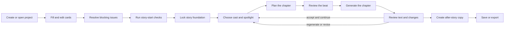
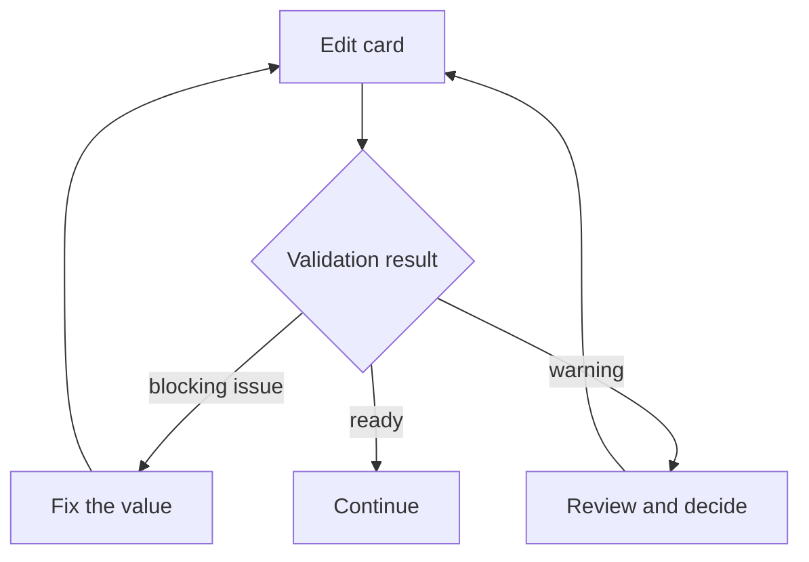
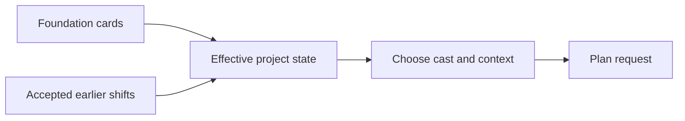
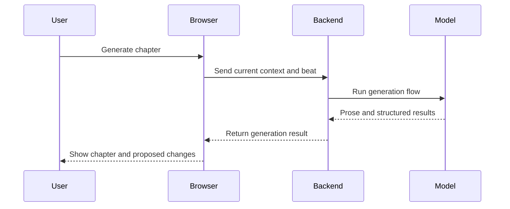
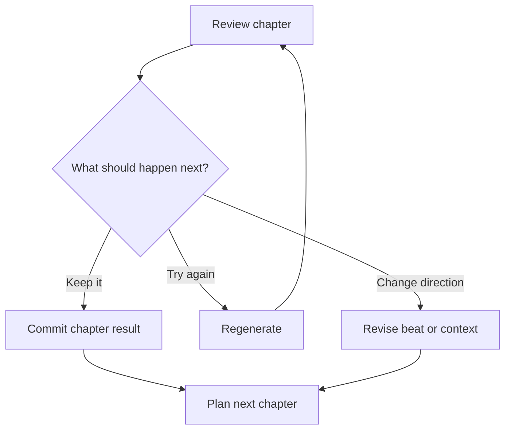

# User guide

Pulpermill guides a story from a small set of foundation cards to a sequence of reviewed chapters. The model proposes content and changes; the browser keeps the project state and the user decides what to keep.

## The workflow at a glance



## 1. Create or open a project

Start with a new project or open an existing project file. The browser loads the project into its active state. Project files contain the story foundation and the story records created as chapters are developed.

You can also import project material where the application provides an import option. Imported content remains editable until it passes the relevant validation and lock rules.

## 2. Fill the story cards

Build the story foundation by editing these cards:

| Card | What it establishes |
|---|---|
| **Style** | Narrative voice and writing qualities |
| **Characters** | People who may take part in the story |
| **World** | Places, objects, groups, rules, and terms |
| **Entanglements** | Relationships and holdings |
| **Setup** | Protagonist, ordinary situation, disruption, and chapter count |
| **Outline** | The beat planned for each chapter |

You can enter values yourself or use model-assisted filling where available. Model filling proposes card content; it does not bypass the browser’s validation or permanently replace your project without the result being applied.

## 3. Resolve blocking issues

Before the story can start, required values and blocking validation issues must be resolved. Warnings are guidance: they may identify a questionable value without preventing you from continuing.



The browser is responsible for deciding whether the project can proceed. A model judgment can provide additional information, but it does not replace the project’s structural checks.

## 4. Start the story

Starting the story runs the story-start checks, including the style-fit check for the protagonist and style.

When the story starts, the five foundation cards are locked:

- Style
- Characters
- World
- Entanglements
- Setup

The Outline remains available for shaping upcoming chapters. Later chapter work uses the foundation as the stable base and incorporates accepted changes through the effective state.

> **Important:** Starting the story is the transition from preparing the foundation to developing chapters. Review the foundation before starting because its main cards are no longer ordinary editing surfaces afterward.

## 5. Prepare a chapter

Before planning, choose the context for the next chapter. The browser prepares an effective project state using the foundation and accepted changes from earlier chapters. It then selects the cast and relevant context for the chapter.

The chapter context can include a spotlight relationship, pressure, location, time, and selected world material.



## 6. Plan the chapter

Use the Plan action to request a structured beat for the next chapter. The plan describes the immediate situation the writer should develop, including:

- Chapter number
- Location
- Time
- Cast
- Spotlight
- Pressure
- Aim
- Plan
- Intended outcome

Review the proposed beat before generating prose. A plan is a useful point to correct direction: it is cheaper to change the scene’s aim or cast before writing the chapter.

## 7. Generate and review the chapter

Use Generate after the beat is ready. The generation operation produces:

1. Chapter prose
2. A summary of what happened
3. A summary of what changed
4. Proposed relationship shifts, where applicable



The result is shown for review. The model does not directly mutate the project. The browser validates the returned references and applies the accepted result to the project state.

## 8. Continue, revise, or regenerate

After reviewing a chapter, you can:

- Continue to the next chapter
- Regenerate the current chapter
- Revise the available planning context and generate again
- Undo or reject an applied result where the interface provides that option

When a chapter result is accepted, its chapter record, event summary, and applicable shifts become available to later chapter planning.



## 9. Finish the story

When you finish developing chapters, the end-story interface creates the after-story copy from the browser’s current project state. This is a local browser-side operation in the current workflow.

The backend has a registered `finish` model-call capability, but the current end-story panel does not use that call for its after-story operation.

## 10. Save and export

Save the project when you want to preserve the complete editable state. Export options can produce the story and project materials in the formats supported by the browser application.

The browser is the source of the saved project state:

```text
Cards + outline + chapters + events + accepted shifts
                         ↓
                  saved or exported project
```

## A small example

Imagine a project with:

| Area | Example |
|---|---|
| Style | Close, past-tense harbor noir |
| Characters | Mara, a harbor clerk; Iven, her estranged brother |
| World | A customs office and a lighthouse on the Salt Coast |
| Entanglement | Mara distrusts Iven; Iven holds the lighthouse key |
| Setup | The lighthouse signal changes during Mara’s ordinary shift |
| Beat | Mara confronts Iven at the customs office |

The user can then:

1. Review the foundation and start the story.
2. Select Mara and Iven for the chapter cast.
3. Plan the confrontation.
4. Review the proposed aim, pressure, and outcome.
5. Generate the chapter.
6. Review the prose and the proposed change to the relationship.
7. Accept the result so the next chapter can use the updated effective relationship state.

## What remains under user control

Pulpermill keeps the user in control of the project at each important boundary:

- Card values are editable before their story-start locks apply.
- Plans can be reviewed before prose is generated.
- Generated prose and structured changes can be reviewed before they become project state.
- Earlier results can be regenerated or undone where the interface supports it.
- The browser owns saving and exporting the project.
