# Value flow

Pulpermill does not send every card field directly to the model. A value may be selected, transformed into prose, used to choose context, or kept only for browser-side validation.

## The complete path

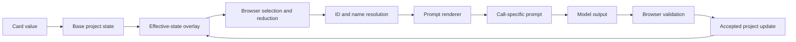

The browser is the point where project values are selected, combined, and finally committed. The backend and prompter receive the context prepared for the current operation.

## Four ways a value can matter

| Path | Meaning | Example |
|---|---|---|
| **Direct prompt material** | A value is included in model-facing context with light formatting | A character’s name and description |
| **Rendered instruction** | A value is converted into natural-language guidance | A Style option becomes a writing instruction |
| **Selection input** | A value helps the browser decide what context to send | A holding keeps an object or place relevant |
| **Code-only state** | A value affects validation or application but is not sent as story material | An internal ID or lock flag |

Many values use more than one path.

## Base state and effective state

The original project remains the base state. Accepted chapter shifts are overlaid before later planning and generation.

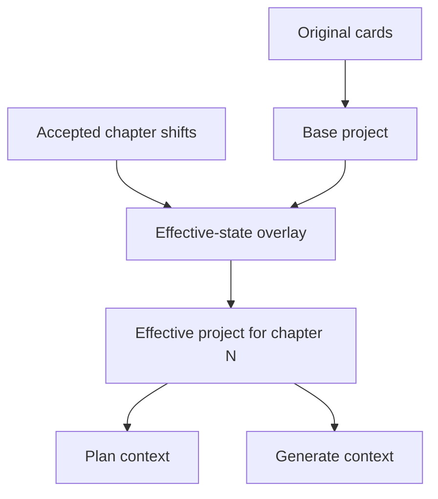

The effective state primarily changes the character and entanglement context used by later chapters. The original cards remain the foundation from which the evolving state is derived.

## Style values

Style values are mainly transformed into model-facing instructions rather than sent as raw option codes.

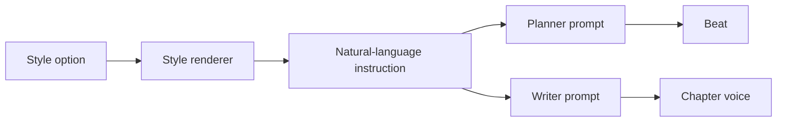

Style affects qualities such as:

- Narrative person
- Tense
- Narrative distance
- Rhythm
- Diction
- Formality
- Imagery
- Humor
- Pacing
- Attitude
- Directness
- Voice difference

The model generally receives the expanded instruction or rendered style material, not only an internal option value such as `close` or `past`.

### Example

```text
Card value:
distance = close

Prompt material:
Give the protagonist's perceptions and plain thoughts, in the narrator's own words.

Story impact:
The chapter can present the protagonist's direct perceptions and thoughts.
```

Style values can therefore affect both planning and prose, although the writer receives the fuller set of sentence-level craft instructions.

## Character values

Character data becomes model-facing portrait and behavior context.

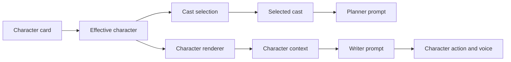

Character values can affect:

- Whether the character is selected for a chapter
- The planner’s understanding of the character
- The writer’s portrait of the character
- How motivations, behaviors, competence, vulnerability, and history appear through choices and actions

The browser decides which characters are in the current cast. The renderer then presents the selected characters as model-facing context.

### Later-chapter feedback

When accepted chapter changes update supported character state, later effective character context can differ from the original card. This allows the story to reflect development without replacing the original foundation card.

## World values

World values supply setting and vocabulary context, but the browser usually reduces the world before the prompt is built.

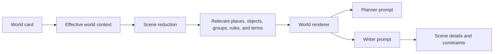

World values can affect:

- Where a scene can happen
- Which objects can be used or mentioned
- Which groups or powers shape the situation
- Which rules constrain action
- Which terms and vocabulary make the setting specific

The selected beat location, held items, pressure, and other required context can cause particular world entries to be retained during reduction. The model does not necessarily receive every world item in every call.

### Example

```text
World card:
Place: the Salt Coast customs office
Object: a lighthouse key

Entanglement:
Iven holds the lighthouse key

Scene reduction:
The customs office and the held key remain relevant

Story impact:
The chapter can stage the confrontation in the office and make the key part of the conflict.
```

## Entanglement values

Entanglements contain ties and holdings. They connect characters, groups, places, and objects to the current story situation.

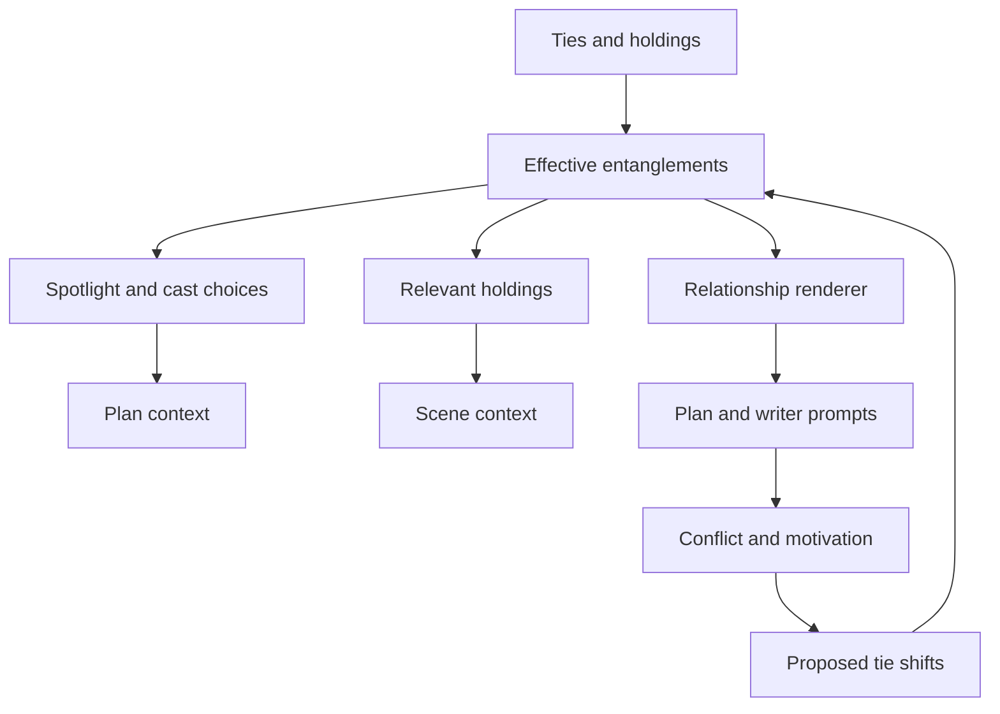

Entanglements can affect:

- Which relationship is available as the spotlight
- Which people or groups are relevant to the scene
- Which held objects or places should be included
- The relationship context shown to the model
- The relationship changes proposed after a chapter
- The effective relationship state used by later chapters

The evolving relationship `edge` is especially important to continuity. Accepted shifts change the effective relationship context for later calls.

### Example

```text
Initial tie:
Mara distrusts Iven

Planner effect:
The tie can become the chapter spotlight or pressure

Writer effect:
The relationship informs what Mara notices, expects, and says

Generated shift:
The relationship edge changes after the confrontation

Later effect:
The next chapter receives the updated effective tie
```

## Setup values

Setup establishes the initial story direction.

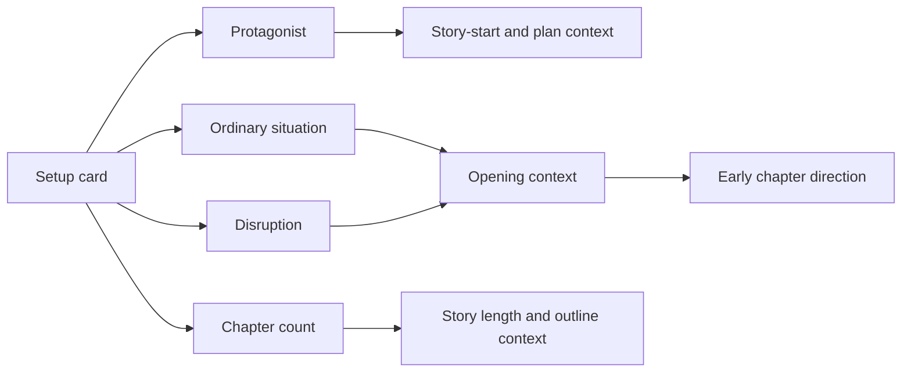

Setup values can affect:

- Which character is the protagonist
- Whether story-start checks can pass
- The starting situation and opening direction
- The initial disruption that gives the story motion
- The expected number of chapters

Setup is more important to the story foundation and early planning than to the detailed prose of every later scene.

## Outline beat values

The beat is the closest structured input to the current chapter.

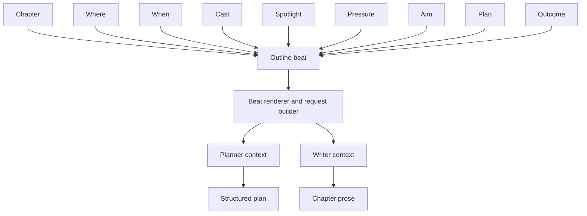

Beat values determine the immediate situation the writer is asked to develop:

- **Chapter** identifies the position in the story.
- **Where** and **when** establish the scene frame.
- **Cast** determines who is available to act.
- **Spotlight** identifies the relationship or connection receiving attention.
- **Pressure** identifies the immediate difficulty.
- **Aim** gives the scene direction.
- **Plan** describes the intended path.
- **Outcome** describes what should be true when the scene ends.

The beat is still a proposal or editable planning record until the browser accepts it.

## Chapter history

Earlier chapter information carries continuity into later calls.

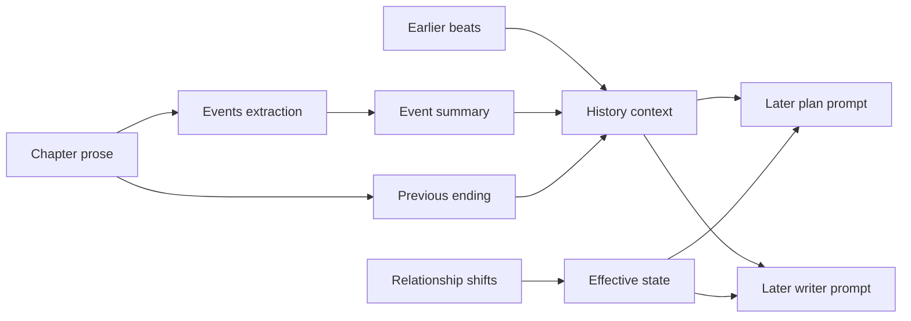

Later planning and writing can receive:

- Earlier beats
- Summaries of what happened
- Summaries of what changed
- Previous chapter endings
- Relationship-edge history
- Accepted shifts

This is how a later prompt sees both the evolving state and a compact account of what has already happened.

## Planner and writer receive different views

The planner and writer do not receive identical prompt material.

| Context | Planner | Writer |
|---|---:|---:|
| Style and tone | Yes | Yes |
| Setup | Yes | Yes |
| Selected cast | Yes | Yes, with fuller portraits |
| World context | Reduced planning context | Fuller scene context |
| Entanglements | Relevant planning relationships | Relationship and holdings context |
| Earlier beats and events | Yes | Yes, as story history |
| Previous ending | Planning-dependent | Important continuity context |
| Current beat | Produces it | Uses it as the scene brief |
| Sentence-level craft direction | Limited | Full writing direction |

The browser and renderers shape these scopes before the call reaches the model.

## IDs, names, and handles

Identifiers serve code-side linking; the model generally needs readable names and descriptions.

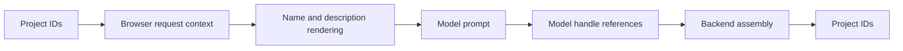

The browser preserves IDs so records can be applied safely. Prompt material generally presents names, descriptions, and readable relationships. Structured model replies may use short handles for referenced items; backend assembly maps those handles back to the project’s IDs and validates them.

## What does not directly become story prose

Some values support the system without being written into the chapter as content:

| Value type | Main role |
|---|---|
| Internal IDs | Link records safely in code |
| Lock state | Control what the user may edit |
| Validation flags | Permit or block workflow transitions |
| Stale markers | Indicate that an outline result needs attention |
| Chapter number metadata | Order and track story records |
| Seed or reduction metadata | Make context selection deterministic |

These values can still affect what the model receives indirectly by controlling selection, validation, or workflow state.

## The continuity loop

The most important feedback loop is the relationship loop:

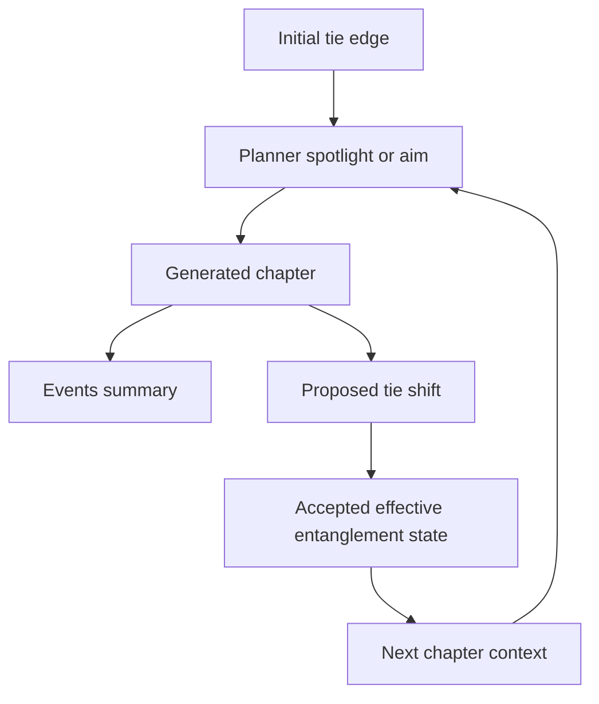

The final story is therefore produced by both:

1. The original foundation cards and planned beats.
2. The accepted consequences of earlier generated chapters.

## Summary

The browser turns project data into a call-specific view before the model sees it:

```text
card value
→ effective state
→ selected context
→ rendered prompt material
→ model proposal or prose
→ validated browser result
→ accepted story state
→ later chapter context
```

The important distinction is between a value’s **storage form**, its **prompt form**, and its **story effect**. A field may be stored as an option, rendered as an instruction, used to select context, and finally expressed through a character choice, scene detail, relationship change, or chapter outcome.
